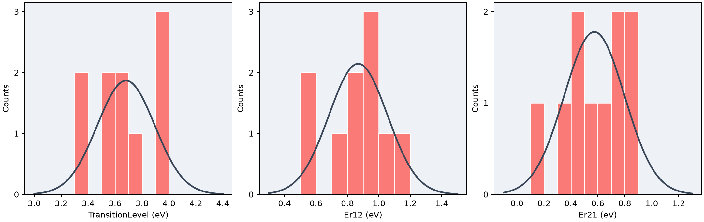

# VO@HfO2 (0/-1)

统计目录中的 10 条记录。001 来自原始 DFT 计算，002–010 为随机生成的测试数据。
统计直接使用 JSON 中的三个能量字段。转变能级相对于 PBE VBM。方差为总体方差，分母为记录数 N。

## 汇总统计

| 参数 | 平均值（eV） | 总体方差（eV²） |
|---|---:|---:|
| TransitionLevel | 3.681476 | 0.045676 |
| Er12 | 0.868393 | 0.034624 |
| Er21 | 0.574174 | 0.050420 |

## 能量分布

柱高为每个 0.1 eV 区间内的记录数。深色曲线为高斯拟合，使用表中的平均值与总体方差，并按记录数和组距缩放到计数尺度。

## 逐条数据（eV）

| 编号 | TransitionLevel | Er12 | Er21 |
|---|---:|---:|---:|
| [001](001/VO_HfO2_0_minus1.json) | 3.507030 | 0.768453 | 0.382082 |
| [002](002/VO_HfO2_0_minus1.json) | 3.997635 | 0.515218 | 0.420418 |
| [003](003/VO_HfO2_0_minus1.json) | 3.384263 | 0.579401 | 0.149210 |
| [004](004/VO_HfO2_0_minus1.json) | 3.679054 | 0.879527 | 0.744682 |
| [005](005/VO_HfO2_0_minus1.json) | 3.593528 | 0.946035 | 0.870545 |
| [006](006/VO_HfO2_0_minus1.json) | 3.928229 | 1.091546 | 0.755465 |
| [007](007/VO_HfO2_0_minus1.json) | 3.634809 | 0.889243 | 0.512074 |
| [008](008/VO_HfO2_0_minus1.json) | 3.961901 | 0.948682 | 0.432193 |
| [009](009/VO_HfO2_0_minus1.json) | 3.389419 | 0.958629 | 0.871509 |
| [010](010/VO_HfO2_0_minus1.json) | 3.738891 | 1.107193 | 0.603566 |
