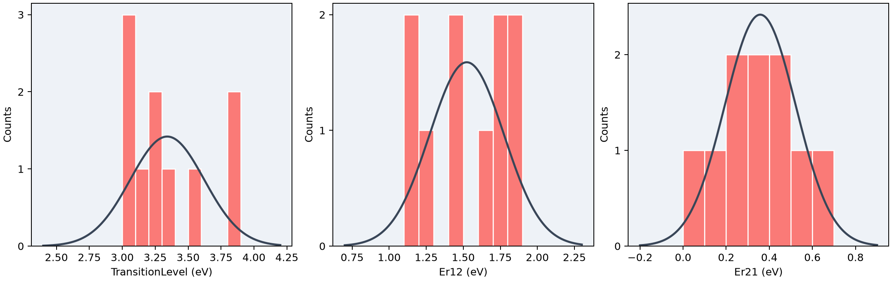

# VO@HfO2 (+1/0)

统计目录中的 10 条记录。001 来自原始 DFT 计算，002–010 为随机生成的测试数据。
统计直接使用 JSON 中的三个能量字段。转变能级相对于 PBE VBM。方差为总体方差，分母为记录数 N。

## 汇总统计

| 参数 | 平均值（eV） | 总体方差（eV²） |
|---|---:|---:|
| TransitionLevel | 3.341389 | 0.078951 |
| Er12 | 1.523572 | 0.063066 |
| Er21 | 0.358007 | 0.027225 |

## 能量分布

柱高为每个 0.1 eV 区间内的记录数。深色曲线为高斯拟合，使用表中的平均值与总体方差，并按记录数和组距缩放到计数尺度。

## 逐条数据（eV）

| 编号 | TransitionLevel | Er12 | Er21 |
|---|---:|---:|---:|
| [001](001/VO_HfO2_plus1_0.json) | 3.389506 | 1.419785 | 0.290108 |
| [002](002/VO_HfO2_plus1_0.json) | 3.033235 | 1.765434 | 0.071777 |
| [003](003/VO_HfO2_plus1_0.json) | 3.541430 | 1.489315 | 0.285720 |
| [004](004/VO_HfO2_plus1_0.json) | 3.840912 | 1.822614 | 0.430414 |
| [005](005/VO_HfO2_plus1_0.json) | 3.231017 | 1.149751 | 0.667742 |
| [006](006/VO_HfO2_plus1_0.json) | 3.081368 | 1.235844 | 0.407758 |
| [007](007/VO_HfO2_plus1_0.json) | 3.182170 | 1.726726 | 0.526672 |
| [008](008/VO_HfO2_plus1_0.json) | 3.233486 | 1.602139 | 0.380777 |
| [009](009/VO_HfO2_plus1_0.json) | 3.075479 | 1.828726 | 0.378883 |
| [010](010/VO_HfO2_plus1_0.json) | 3.805288 | 1.195390 | 0.140222 |
